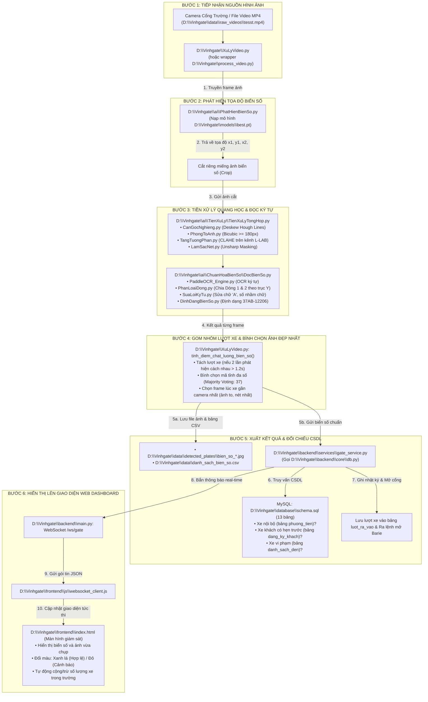

# HƯỚNG DẪN KIẾN TRÚC & LUỒNG HOẠT ĐỘNG HỆ THỐNG VINHGATE  (BẢN HỢP NHẤT)
> **Tài liệu hướng dẫn trực quan dành thành viên nhóm và hội đồng đánh giá.**  
> Mục tiêu: Đọc xong là hiểu ngay từng file làm nhiệm vụ gì, nằm ở đường dẫn chính xác nào trên máy, file nào gọi file nào, và dữ liệu đi từ Camera đến Web/CSDL ra sao.

---

## 📍 PHẦN 1: BẢNG ĐƯỜNG DẪN ĐẦY ĐỦ & CHỨC NĂNG TỪNG FILE

> 💡 **Thư mục gốc của dự án trên máy tính:** `D:\Vinhgate\`

Hệ thống đã được module hóa chuyên sâu (chia tách độc lập từng khâu tiền xử lý, OCR và nghiệp vụ) kèm theo tên file tiếng Việt trực quan phục vụ báo cáo đồ án:

| Tên File | Đường Dẫn Tuyệt Đối Trên Máy Tính | Đường Dẫn Trong Dự Án | Chức Năng Cụ Thể |
| :--- | :--- | :--- | :--- |
| **`XuLyVideo.py`** | [`D:\Vinhgate\XuLyVideo.py`](file:///d:/Vinhgate/XuLyVideo.py) | `XuLyVideo.py` | **[ĐIỂM BẮT ĐẦU 1]** File chạy chính khi kiểm thử video offline (`python XuLyVideo.py <video>`). Tích hợp Session Tracking gom lượt xe và Majority Voting bình chọn biển số nét nhất. |
| **`process_video.py`** | [`D:\Vinhgate\process_video.py`](file:///d:/Vinhgate/process_video.py) | `process_video.py` | File wrapper tương thích ngược (gọi trực tiếp sang `XuLyVideo.py`). |
| **`backend/main.py`** | [`D:\Vinhgate\backend\main.py`](file:///d:/Vinhgate/backend/main.py) | `backend/main.py` | **[ĐIỂM BẮT ĐẦU 2]** File chạy chính khi vận hành toàn bộ hệ thống máy chủ FastAPI, mở cổng kết nối thời gian thực WebSocket `/ws/gate` đến giao diện Web. |
| **`ai/PhatHienBienSo.py`**| [`D:\Vinhgate\ai\PhatHienBienSo.py`](file:///d:/Vinhgate/ai/PhatHienBienSo.py) | `ai/PhatHienBienSo.py` | Nạp mô hình YOLOv8 (`models/best.pt`), quét từng khung hình để phát hiện vị trí biển số (Bounding Box) và gọi các module tiền xử lý/OCR. (Có wrapper `ai/detector.py`). |
| **`ai/CatKhungHinh.py`** | [`D:\Vinhgate\ai\CatKhungHinh.py`](file:///d:/Vinhgate/ai/CatKhungHinh.py) | `ai/CatKhungHinh.py` | Dùng AI lọc thông minh, chỉ cắt các khung hình có xe máy/ô tô từ video để đưa lên Roboflow gán nhãn, loại bỏ 100% frame đường trống. |
| **`ai/TheoDoiHuongXe.py`**| [`D:\Vinhgate\ai\TheoDoiHuongXe.py`](file:///d:/Vinhgate/ai/TheoDoiHuongXe.py) | `ai/TheoDoiHuongXe.py` | Thuật toán ByteTrack theo dõi vector chuyển động của xe trước camera để xác định xe đang đi VÀO hay đi RA và chống đếm lặp. (Có wrapper `ai/tracker.py`). |
| **`ai/TienXuLy/`** | [`D:\Vinhgate\ai\TienXuLy\`](file:///d:/Vinhgate/ai/TienXuLy) | `ai/TienXuLy/` | **Gói Module Tiền Xử Lý Ảnh Chuyên Sâu**: |
| • `CanGocNghieng.py` | [`D:\Vinhgate\ai\TienXuLy\CanGocNghieng.py`](file:///d:/Vinhgate/ai/TienXuLy/CanGocNghieng.py) | `ai/TienXuLy/CanGocNghieng.py` | Thuật toán Deskew (Hough Lines) tự động xoay thẳng biển số về góc 0° khi xe chạy chéo góc cổng. |
| • `PhongToAnh.py` | [`D:\Vinhgate\ai\TienXuLy\PhongToAnh.py`](file:///d:/Vinhgate/ai/TienXuLy/PhongToAnh.py) | `ai/TienXuLy/PhongToAnh.py` | Phóng to nội suy bậc ba (Bicubic) đảm bảo chiều rộng biển số đạt chuẩn $\ge 180$px cho OCR. |
| • `TangTuongPhan.py` | [`D:\Vinhgate\ai\TienXuLy\TangTuongPhan.py`](file:///d:/Vinhgate/ai/TienXuLy/TangTuongPhan.py) | `ai/TienXuLy/TangTuongPhan.py` | Cân bằng tương phản thích ứng CLAHE trên kênh độ sáng L (không gian màu LAB), triệt tiêu lóa sáng/bóng râm. |
| • `LamSacNet.py` | [`D:\Vinhgate\ai\TienXuLy\LamSacNet.py`](file:///d:/Vinhgate/ai/TienXuLy/LamSacNet.py) | `ai/TienXuLy/LamSacNet.py` | Làm nét cạnh ký tự bằng Unsharp Masking để khử nhòe chuyển động khi xe đang chạy. |
| • `TienXuLyTongHop.py`| [`D:\Vinhgate\ai\TienXuLy\TienXuLyTongHop.py`](file:///d:/Vinhgate/ai/TienXuLy/TienXuLyTongHop.py) | `ai/TienXuLy/TienXuLyTongHop.py` | Pipeline kết nối tuần tự 4 bước tiền xử lý trên. |
| **`ai/ChuanHoaBienSo/`** | [`D:\Vinhgate\ai\ChuanHoaBienSo\`](file:///d:/Vinhgate/ai/ChuanHoaBienSo) | `ai/ChuanHoaBienSo/` | **Gói Module Nhận Dạng OCR & Chuẩn Hóa Biển Số VN**: |
| • `DocBienSo.py` | [`D:\Vinhgate\ai\ChuanHoaBienSo\DocBienSo.py`](file:///d:/Vinhgate/ai/ChuanHoaBienSo/DocBienSo.py) | `ai/ChuanHoaBienSo/DocBienSo.py` | Hàm điều phối trọn gói: Tiền xử lý $\to$ OCR $\to$ Phân loại dòng $\to$ Sửa lỗi $\to$ Chuỗi kết quả. |
| • `PaddleOCR_Engine.py`| [`D:\Vinhgate\ai\ChuanHoaBienSo\PaddleOCR_Engine.py`](file:///d:/Vinhgate/ai/ChuanHoaBienSo/PaddleOCR_Engine.py) | `ai/ChuanHoaBienSo/PaddleOCR_Engine.py` | Quản lý Engine OCR với kiến trúc Singleton và cơ chế tự động chuyển dự phòng sang EasyOCR. |
| • `PhanLoaiDong.py` | [`D:\Vinhgate\ai\ChuanHoaBienSo\PhanLoaiDong.py`](file:///d:/Vinhgate/ai/ChuanHoaBienSo/PhanLoaiDong.py) | `ai/ChuanHoaBienSo/PhanLoaiDong.py` | Phân tích tọa độ trục Y để ghép đúng Dòng 1 (tỉnh + seri) và Dòng 2 (dãy số thứ tự). |
| • `SuaLoiKyTu.py` | [`D:\Vinhgate\ai\ChuanHoaBienSo\SuaLoiKyTu.py`](file:///d:/Vinhgate/ai/ChuanHoaBienSo/SuaLoiKyTu.py) | `ai/ChuanHoaBienSo/SuaLoiKyTu.py` | Sửa các lỗi quang học đặc thù: sửa số thành chữ tại vị trí sê-ri, khôi phục chữ `'A'` từ `@`, `W`, `HB`. |
| • `DinhDangBienSo.py` | [`D:\Vinhgate\ai\ChuanHoaBienSo\DinhDangBienSo.py`](file:///d:/Vinhgate/ai/ChuanHoaBienSo/DinhDangBienSo.py) | `ai/ChuanHoaBienSo/DinhDangBienSo.py` | Định dạng chuẩn biển số VN: xe 50cc sinh viên (`37AB-12206`), xe máy thường (`37K1-66062`), ô tô (`37A-12345`). |
| **`models/best.pt`** | [`D:\Vinhgate\models\best.pt`](file:///d:/Vinhgate/models/best.pt) | `models/best.pt` | File trọng số YOLOv8 đã huấn luyện nhận diện nhãn `bien_so`. |
| **`backend/core/config.py`** | [`D:\Vinhgate\backend\core\config.py`](file:///d:/Vinhgate/backend/core/config.py) | `backend/core/config.py` | Định nghĩa đường dẫn gốc `BASE_DIR`, cấu hình cổng mạng, đọc file `.env`. |
| **`backend/core/db.py`** | [`D:\Vinhgate\backend\core\db.py`](file:///d:/Vinhgate/backend/core/db.py) | `backend/core/db.py` | Quản lý kết nối cơ sở dữ liệu MySQL bằng `pymysql` (DictCursor). |
| **`backend/services/gate_service.py`** | [`D:\Vinhgate\backend\services\gate_service.py`](file:///d:/Vinhgate/backend/services/gate_service.py) | `backend/services/gate_service.py` | Đối chiếu biển số với CSDL, đếm số xe trong trường, mở Barie và cảnh báo Blacklist. |
| **`backend/services/guest_service.py`**| [`D:\Vinhgate\backend\services\guest_service.py`](file:///d:/Vinhgate/backend/services/guest_service.py) | `backend/services/guest_service.py` | Đăng ký xe khách công tác: cấp mã tạm, khung giờ hiệu lực và bắt xe ở lại quá giờ. |
| **`backend/routers/api_gate.py`** | [`D:\Vinhgate\backend\routers\api_gate.py`](file:///d:/Vinhgate/backend/routers/api_gate.py) | `backend/routers/api_gate.py` | API xử lý lượt xe qua cổng, xác nhận tay biển số mờ. |
| **`backend/routers/api_vehicles.py`** | [`D:\Vinhgate\backend\routers\api_vehicles.py`](file:///d:/Vinhgate/backend/routers/api_vehicles.py) | `backend/routers/api_vehicles.py` | API CRUD quản lý phương tiện cán bộ, sinh viên và danh sách xe cấm. |
| **`backend/routers/api_stats.py`** | [`D:\Vinhgate\backend\routers\api_stats.py`](file:///d:/Vinhgate/backend/routers/api_stats.py) | `backend/routers/api_stats.py` | API thống kê lưu lượng xe, xuất báo cáo Excel. |
| **`database/schema.sql`** | [`D:\Vinhgate\database\schema.sql`](file:///d:/Vinhgate/database/schema.sql) | `database/schema.sql` | Kịch bản tạo 13 bảng CSDL chuẩn 3NF và 2 Views thống kê. |
| **`database/seed_data.sql`** | [`D:\Vinhgate\database\seed_data.sql`](file:///d:/Vinhgate/database/seed_data.sql) | `database/seed_data.sql` | Dữ liệu mẫu ban đầu của ĐH Vinh. |
| **`frontend/index.html`** | [`D:\Vinhgate\frontend\index.html`](file:///d:/Vinhgate/frontend/index.html) | `frontend/index.html` | Màn hình Giám sát trực tiếp: khung camera, biển số vừa nhận diện, trạng thái barie, đếm xe trong bãi. |
| **`frontend/vehicles.html`** | [`D:\Vinhgate\frontend\vehicles.html`](file:///d:/Vinhgate/frontend/vehicles.html) | `frontend/vehicles.html` | Màn hình Quản lý danh sách phương tiện nội bộ và lập phiếu xe khách. |
| **`frontend/history.html`** | [`D:\Vinhgate\frontend\history.html`](file:///d:/Vinhgate/frontend/history.html) | `frontend/history.html` | Màn hình Tra cứu lịch sử xe ra vào và xuất báo cáo Excel. |
| **`frontend/js/websocket_client.js`** | [`D:\Vinhgate\frontend\js\websocket_client.js`](file:///d:/Vinhgate/frontend/js/websocket_client.js) | `frontend/js/websocket_client.js` | Nhận kết quả biển số theo thời gian thực từ Backend qua WebSocket. |
| **`frontend/js/charts.js`** | [`D:\Vinhgate\frontend\js\charts.js`](file:///d:/Vinhgate/frontend/js/charts.js) | `frontend/js/charts.js` | Vẽ biểu đồ lưu lượng xe 24 giờ bằng Chart.js. |
| **`.env`** | [`D:\Vinhgate\.env`](file:///d:/Vinhgate/.env) | `.env` | File cấu hình thông số kết nối MySQL (`DB_HOST`, `DB_USER`, `DB_PASSWORD=hung123`, `DB_NAME`). |
| **`data/detected_plates/`** | [`D:\Vinhgate\data\detected_plates\`](file:///d:/Vinhgate/data/detected_plates) | `data/detected_plates/` | Thư mục tự động lưu lại các bức ảnh cắt biển số rõ nét nhất của từng lượt xe. |
| **`data/danh_sach_bien_so.csv`**| [`D:\Vinhgate\data\danh_sach_bien_so.csv`](file:///d:/Vinhgate/data/danh_sach_bien_so.csv) | `data/danh_sach_bien_so.csv` | File bảng CSV tổng hợp kết quả (STT, Biển số, Loại xe, Giờ, Độ tin cậy). |
| **`docs/LUONG_HOAT_DONG_HE_THONG.md`** | [`D:\Vinhgate\docs\LUONG_HOAT_DONG_HE_THONG.md`](file:///d:/Vinhgate/docs/LUONG_HOAT_DONG_HE_THONG.md) | `docs/LUONG_HOAT_DONG_HE_THONG.md` | Tài liệu kiến trúc phân tầng End-to-End của hệ thống. |
| **`docs/QUY_UOC_DU_LIEU.md`** | [`D:\Vinhgate\docs\QUY_UOC_DU_LIEU.md`](file:///d:/Vinhgate/docs/QUY_UOC_DU_LIEU.md) | `docs/QUY_UOC_DU_LIEU.md` | Tài liệu quy chuẩn đặt tên video/ảnh và phân chia dữ liệu Temporal Split chống rò rỉ dữ liệu. |

---

## 🔄 PHẦN 2: LUỒNG HOẠT ĐỘNG TRỰC QUAN (FILE NÀO GỌI FILE NÀO?)



---

## ⚡ PHẦN 3: CÁCH CHẠY DỰ ÁN TRÊN POWERSHELL

### 1. Chạy phân tích nhận diện video (Chế độ Kiểm thử AI)
Bạn có thể chạy bằng script tiếng Việt mới:
```powershell
python D:\Vinhgate\XuLyVideo.py data/raw_videos/tesst.mp4
```
Hoặc bằng script wrapper tiếng Anh quen thuộc:
```powershell
python D:\Vinhgate\process_video.py data/raw_videos/tesst.mp4
```

### 2. Chạy toàn bộ Máy chủ Backend & Giao diện Web
```powershell
uvicorn backend.main:app --host 127.0.0.1 --port 8000 --reload
```
👉 Truy cập Web:
- **Giám sát trực tiếp:** `http://localhost:8000/frontend/index.html`
- **Quản lý Xe & Khách:** `http://localhost:8000/frontend/vehicles.html`
- **Lịch sử & Báo cáo:** `http://localhost:8000/frontend/history.html`
- **Tài liệu API Swagger:** `http://localhost:8000/docs`
