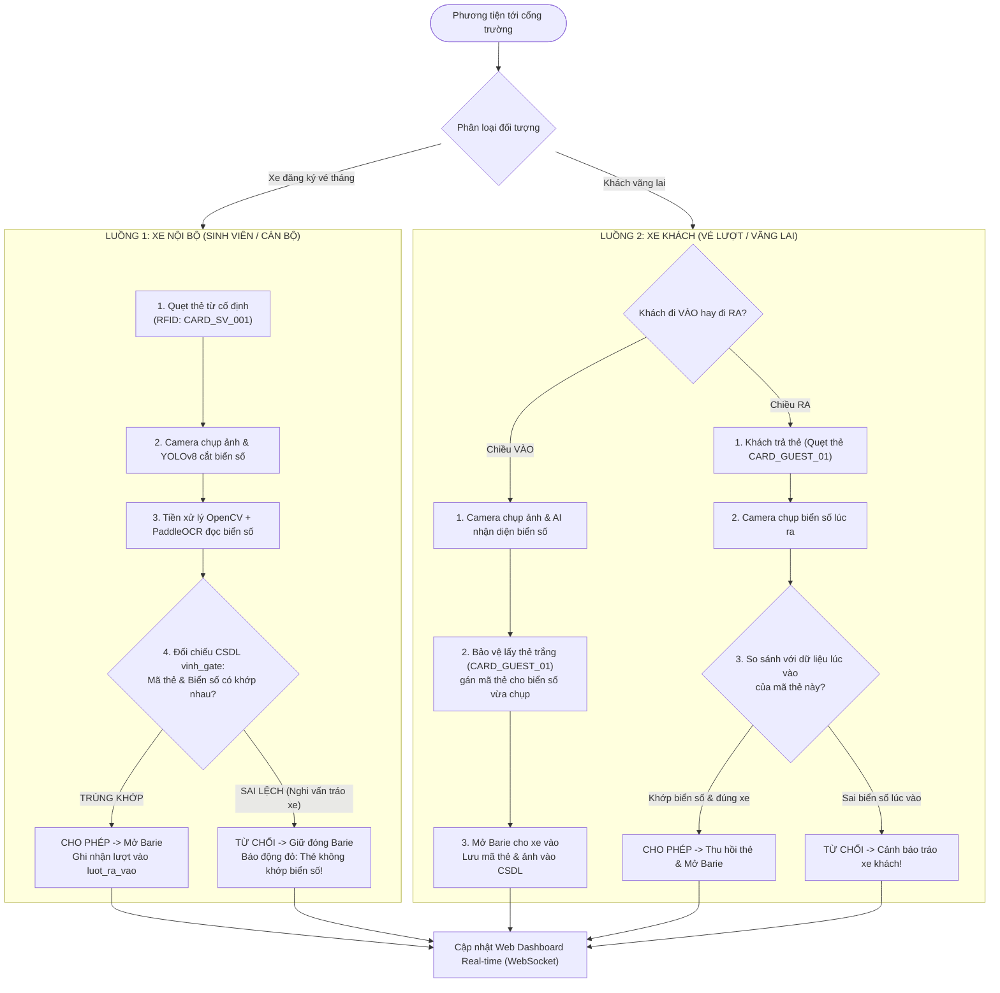

<div align="center">
  <h1>VINHGATE — HỆ THỐNG QUẢN LÝ XE RA VÀO ĐẠI HỌC VINH</h1>
  <h3>ỨNG DỤNG THỊ GIÁC MÁY TÍNH KẾT HỢP THẺ TỪ ĐỊNH DANH (RFID) TRONG XÂY DỰNG KHUÔN VIÊN THÔNG MINH</h3>
  <p><strong>Công nghệ sử dụng:</strong> Python 3 · YOLOv8 · OpenCV · PaddleOCR / EasyOCR · Thẻ từ RFID · FastAPI · WebSocket · MySQL 8.0 · Chart.js</p>
</div>

---

<a id="muc-luc"></a>
## 📑 Mục lục

- [1. Giới thiệu đề tài & Bối cảnh](#1-gioi-thieu)
- [2. Chức năng hệ thống](#2-chuc-nang)
- [3. Luồng hoạt động & Thuật toán cốt lõi](#3-thuat-toan)
- [4. Kiến trúc công nghệ & Tổ chức ứng dụng](#4-cong-nghe)
- [5. Cơ sở dữ liệu 13 bảng & Views thống kê](#5-co-so-du-lieu)
- [6. Hướng dẫn cài đặt & Vận hành](#6-cai-dat)
- [7. Dữ liệu thử nghiệm & Kịch bản test nhanh](#7-du-lieu-demo)
- [8. Kịch bản trình diễn trước Hội đồng (10–15 phút)](#8-kich-ban-demo)
- [9. Cấu trúc thư mục dự án](#9-cau-truc-thu-muc)
- [10. Kiểm thử & Đánh giá độ chính xác](#10-kiem-thu)
- [11. Lỗi thường gặp & Cách khắc phục](#11-loi-thuong-gap)
- [12. Giới hạn hiện tại & Hướng phát triển](#12-gioi-han-phat-trien)

---

<a id="1-gioi-thieu"></a>
## 1. Giới thiệu đề tài & Bối cảnh

Tại các cổng ra vào của Trường Đại học Vinh (đặc biệt là Cổng chính đường Lê Duẩn, khu vực Nhà xe 1 và Nhà xe 2), lưu lượng phương tiện của cán bộ giảng viên, sinh viên và khách liên hệ công tác vào các khung giờ cao điểm sáng và chiều là rất lớn. Việc kiểm soát thủ công bằng mắt thường hoặc ghi vé giấy bộc lộ nhiều hạn chế:
- Dễ gây ùn ứ kéo dài tại cổng trường.
- Khó kiểm soát đối tượng lạ, nguy cơ gian lận tráo đổi xe hoặc mất trộm phương tiện.
- Thiếu số liệu thống kê tức thời về số lượng phương tiện thực tế đang lưu lại trong khuôn viên trường.

Theo yêu cầu chuẩn hóa từ thực tiễn bãi đỗ xe thông minh, **Hệ thống VinhGate 2.0** triển khai cơ chế **Xác thực kép (Dual Authentication)** kết hợp giữa **Thẻ từ định danh (RFID/Smart Card)** và **Thị giác máy tính nhận dạng biển số (LPR)**:
1. **Đối với Xe nội bộ (Sinh viên / Giảng viên - Vé tháng):** Thẻ từ được cấp cố định và liên kết với biển số xe đã đăng ký trong cơ sở dữ liệu. Khi vào hoặc ra, người dùng quẹt thẻ kết hợp camera chụp biển số; hệ thống chỉ mở cổng khi cặp **(Mã Thẻ — Biển Số)** hoàn toàn trùng khớp.
2. **Đối với Xe khách (Khách vãng lai / Vé lượt):** Khi xe vào, camera chụp biển số và bảo vệ (hoặc cây cấp thẻ) cấp thẻ từ tạm thời để gán cho biển số đó. Khi xe ra, khách quẹt trả thẻ; hệ thống chụp biển số lúc ra và đối chiếu chéo với ảnh chụp lúc vào, triệt tiêu 100% tình trạng gian lận tráo xe trong bãi.

### Mục tiêu đề tài
- **Cơ chế xác thực kép an toàn cao**: Triệt tiêu rủi ro mất cắp xe nhờ đối chiếu song song mã thẻ từ và biển số nhận diện quang học.
- **Tự động hóa nhận diện**: Nhận dạng chính xác biển số xe ô tô (1 dòng), xe máy thông thường (2 dòng) và xe máy điện/xe 50cc của sinh viên (sê-ri 2 chữ cái như `37AB`, `37AN`).
- **Nâng cao chất lượng ảnh đầu vào**: Ứng dụng chuỗi tiền xử lý quang học OpenCV (cân góc nghiêng Deskew, tăng tương phản cục bộ CLAHE, làm nét cạnh ký tự Unsharp Masking) nhằm khắc phục hiện tượng xe chạy chéo góc, lóa đèn pha hoặc bóng râm.
- **Thuật toán Session Tracking & Majority Voting**: Gom các khung hình liên tiếp của cùng một xe trong khoảng thời gian $\le 1.2$ giây để bình chọn mã tỉnh đa số và trích xuất ra duy nhất một kết quả cùng ảnh chụp rõ nét nhất.
- **Đối chiếu nghiệp vụ chặt chẽ**: Quản lý 3 nhóm phương tiện: Xe nội bộ có thẻ tháng, xe khách có phiếu/thẻ tạm, và xe vi phạm trong danh sách đen (Blacklist).
- **Giám sát thời gian thực**: Cung cấp giao diện Web trực quan với công nghệ WebSocket, hiển thị song song ảnh đối soát lúc Vào/Ra, thống kê lưu lượng xe 24 giờ và hỗ trợ xuất báo cáo Excel đối soát.

---

<a id="2-chuc-nang"></a>
## 2. Chức năng hệ thống

Hệ thống được chia thành hai phân hệ chính: **Phân hệ AI & Thị giác Máy tính** và **Phân hệ Quản trị & Máy chủ Giám sát Cổng**.

### 2.1. Phân hệ AI & Thị giác máy tính
- **Phát hiện biển số tự động**: Sử dụng mô hình YOLOv8 (`models/best.pt`) định vị chính xác vùng chứa biển số xe với độ trễ thấp (< 15ms trên GPU, < 120ms trên CPU).
- **Chuỗi tiền xử lý quang học chuyên sâu (`ai/TienXuLy`)**:
  - *Deskew (Cân góc nghiêng)*: Thuật toán biến đổi Hough Lines tự động xoay ngang biển số khi xe đi chéo góc cổng.
  - *Phóng to ảnh (Bicubic)*: Mở rộng ảnh biển số đạt độ phân giải chuẩn $\ge 180$px phục vụ đọc OCR.
  - *Tăng tương phản (CLAHE)*: Cân bằng biểu đồ độ sáng thích ứng trên kênh L (không gian màu LAB), triệt tiêu hiện tượng bóng râm hoặc lóa sáng đèn pha.
  - *Làm sắc nét viền (Unsharp Masking)*: Khử hiện tượng mờ nhòe chuyển động (motion blur) khi xe đang di chuyển.
- **Nhận dạng OCR & Chuẩn hóa biển số Việt Nam (`ai/ChuanHoaBienSo`)**:
  - Đọc ký tự bằng Engine PaddleOCR kết hợp phân tích tọa độ trục Y để ghép đúng Dòng 1 (mã tỉnh + sê-ri) và Dòng 2 (dãy số thứ tự).
  - Tự động sửa lỗi nhầm lẫn quang học đặc thù (sửa số thành chữ tại vị trí sê-ri; khôi phục chữ `'A'` từ `@`, `W`, `HB`).
  - Định dạng chuẩn biển số Việt Nam (ô tô `37A-12345`, xe máy `37K1-66062`, xe 50cc/điện sinh viên `37AB-12206`).
  - Cơ chế dự phòng (Fallback): Tự động chuyển sang EasyOCR khi môi trường chưa cài đặt thư viện PaddleOCR.
- **Xử lý video ngoại tuyến (`XuLyVideo.py`)**: Đọc file video camera, tự động gom nhóm lượt xe, bình chọn mã tỉnh đa số, lưu ảnh cắt rõ nét nhất vào `data/detected_plates/` và xuất danh sách tổng hợp ra file CSV.
- **Trích xuất khung hình tự động (`ai/CatKhungHinh.py`)**: Lọc thông minh chỉ cắt các frame có phương tiện (loại bỏ 100% frame đường trống) phục vụ tạo tập dữ liệu huấn luyện Roboflow.
- **Xác định hướng xe & Chống đếm lặp (`ai/TheoDoiHuongXe.py`)**: Phân tích biến thiên tọa độ trục Y ($\Delta Y$) để xác định xe đang đi VÀO hay đi RA, kết hợp cơ chế Cooldown/Debounce tránh đếm trùng khi xe dừng chờ mở cổng.

### 2.2. Phân hệ Quản trị & Máy chủ Giám sát (Web Dashboard)
- **Nghiệp vụ xác thực kép Thẻ từ + Biển số xe (`backend/services/gate_service.py`)**:
  - Nhận diện sự kiện quẹt thẻ kết hợp ảnh chụp từ camera cổng.
  - Tự động kiểm tra đối soát chéo: Cảnh báo đỏ tức thì nếu thẻ một đằng nhưng biển số xe một nẻo.
  - Quản lý vòng đời thẻ khách vãng lai: Cấp thẻ tạm lúc vào $\to$ Thu hồi thẻ và đối soát ảnh lúc ra.
- **Bảng giám sát trực ban thời gian thực (`frontend/index.html`)**:
  - Cập nhật số lượng phương tiện thực tế đang có mặt trong trường (Tổng số, Xe máy, Ô tô) qua VIEW CSDL.
  - Hiển thị song song thông tin đối soát: Mã thẻ quẹt, ảnh biển số vừa nhận diện, họ tên chủ xe/đối tượng, kết quả Barie.
  - Điều khiển mô phỏng trạng thái thanh chắn Barie (Đang mở cho qua / Giữ đóng).
  - Hỗ trợ nghiệp vụ **Xác nhận tay (Manual Confirm)**: Cho phép bảo vệ chỉnh sửa biển số khi AI đọc mờ, xử lý trường hợp mất thẻ hoặc biển số bẩn.
  - Bộ nút mô phỏng quẹt thẻ và test nhanh các tình huống thực tế ngay trên giao diện.
- **Hồ sơ phương tiện & Quản lý thẻ (`frontend/vehicles.html`)**:
  - *Quản lý xe nội bộ*: Tra cứu danh sách xe cán bộ, sinh viên; quản lý mã thẻ từ RFID đã gán cho từng xe; thêm mới xe và cấp thẻ.
  - *Phiếu đăng ký xe khách*: Quản lý mã thẻ tạm cấp cho khách công tác, đơn vị, người tiếp đón và khung giờ hiệu lực.
  - *Danh sách đen (Blacklist)*: Quản lý các biển số hoặc mã thẻ bị chặn tuyệt đối vào trường do vi phạm an ninh.
- **Lịch sử ra vào & Thống kê báo cáo (`frontend/history.html`)**:
  - Biểu đồ đường phân bố lưu lượng xe theo 24 giờ trong ngày (sử dụng thư viện Chart.js).
  - Bảng tra cứu nhật ký toàn bộ lượt xe ra vào kèm mã thẻ quẹt và thời gian xử lý AI (ms).
  - Xuất báo cáo lịch sử ra file chuẩn Microsoft Excel (.xlsx) có cột Mã Thẻ phục vụ đối soát định kỳ.

---

<a id="3-thuat-toan"></a>
## 3. Luồng hoạt động & Thuật toán cốt lõi

### 3.1. Sơ đồ luồng hoạt động Xác thực kép (Thẻ từ RFID + AI Biển số)



### 3.2. Thuật toán Session Tracking & Majority Voting
Khi xe tiến qua vạch quét, camera ghi nhận từ 20 đến 80 frame có chứa biển số ở các khoảng cách và góc nhìn khác nhau. Hệ thống triển khai thuật toán:
1. **Gom nhóm phiên (Session Tracker)**: Mọi nhận diện diễn ra cách nhau $\le 1.2$ giây được tự động gom vào cùng 1 phiên xe duy nhất. Khi khoảng trống giữa hai lần quét $> 1.2$ giây, phiên cũ được chốt kết quả và chuyển sang xe tiếp theo.
2. **Bình chọn đa số mã tỉnh (Majority Voting)**: Thống kê tần suất xuất hiện của mã tỉnh 2 số đầu tiên (ví dụ: `37` Nghệ An). Các ứng viên có mã tỉnh trùng với mã đa số được cộng điểm trọng số ưu tiên.
3. **Chấm điểm chất lượng frame (Quality Score)**:
   $$\text{Score} = (\text{OCR\_Conf} \times 0.4) + (\text{YOLO\_Conf} \times 0.2) + \text{Điểm cấu trúc chuẩn} + \text{Tỉ lệ diện tích BBox}$$
   Thuật toán ưu tiên chọn frame khi xe ở gần camera nhất (diện tích biển số lớn nhất, ký tự rõ nét nhất) làm kết quả đại diện và lưu ảnh vào cơ sở dữ liệu.

---

<a id="4-cong-nghe"></a>
## 4. Kiến trúc công nghệ & Tổ chức ứng dụng

### 4.1. Công nghệ sử dụng
- **Ngôn ngữ nền tảng**: Python 3.10 – 3.12 (Hỗ trợ tốt trên Windows & Linux).
- **Học sâu & Thị giác máy tính**:
  - `ultralytics` (YOLOv8n Object Detection) — huấn luyện phát hiện biển số xe Việt Nam.
  - `opencv-python` (OpenCV 4.10+) — xử lý ảnh số, ma trận điểm ảnh, Hough Transform, không gian màu LAB.
  - `paddleocr` / `easyocr` — nhận dạng ký tự quang học.
- **Hạ tầng định danh**:
  - Mô phỏng và tích hợp đầu đọc thẻ từ RFID (giao tiếp USB Virtual COM / Keystroke).
- **Máy chủ Backend**:
  - `FastAPI` — Web framework hiệu năng cao, tự động sinh tài liệu Swagger UI.
  - `uvicorn` — ASGI Server tiêu chuẩn.
  - `WebSockets` — truyền tải dữ liệu sự kiện xe hai chiều thời gian thực.
  - `PyMySQL` — kết nối cơ sở dữ liệu MySQL với `DictCursor`.
  - `openpyxl` — tạo file báo cáo bảng tính Excel định dạng cao cấp.
- **Cơ sở dữ liệu**: MySQL Server 8.0, cấu trúc InnoDB, bảng mã `utf8mb4`.
- **Giao diện Giám sát (Frontend)**:
  - HTML5, CSS3 phong cách Flat Design tối ưu cho máy trạm trực ban.
  - Vanilla JavaScript kết nối WebSocket Client tự động phục hồi (Auto-reconnect).
  - `Chart.js` — trực quan hóa dữ liệu lưu lượng xe 24 giờ.

---

<a id="5-co-so-du-lieu"></a>
## 5. Cơ sở dữ liệu 13 bảng & Views thống kê

Cơ sở dữ liệu chuẩn hóa 3NF được lưu tại file [`database/schema.sql`](file:///d:/Vinhgate/database/schema.sql) và dữ liệu mẫu tại [`database/seed_data.sql`](file:///d:/Vinhgate/database/seed_data.sql).

### 5.1. Phân nhóm các bảng CSDL

#### Nhóm 1: Danh mục & Hạ tầng Cổng (3 bảng)
- `cong`: Danh mục các cổng của Trường ĐH Vinh (Cổng chính Lê Duẩn, Cổng phụ Nguyễn Viết Xuân...).
- `camera`: Quản lý thông tin IP camera, luồng RTSP và cổng phụ trách.
- `vai_tro` & `tai_khoan`: Quản lý người dùng hệ thống và quyền hạn (Quản trị viên, Bảo vệ trực cổng).

#### Nhóm 2: Đối tượng, Phương tiện & Thẻ từ (4 bảng)
- `nguoi_dung`: Thông tin cán bộ, giảng viên và sinh viên ĐH Vinh (Mã SV/CB, Họ tên, Đơn vị, SĐT).
- `phuong_tien`: Thông tin xe vé tháng của SV/cán bộ. Bổ sung cột **`ma_the`** (`VARCHAR(50) UNIQUE`) lưu mã thẻ từ RFID được gán cố định cho xe.
- `khach`: Hồ sơ khách liên hệ công tác tại trường (Họ tên, SĐT, CCCD, Đơn vị công tác).
- `dang_ky_khach`: Quản lý phiếu xe khách tạm thời. Bổ sung cột **`ma_the`** lưu mã thẻ tạm cấp cho khách vãng lai.

#### Nhóm 3: Sự kiện Ra Vào & An Ninh (4 bảng)
- `luot_ra_vao`: Nhật ký từng lượt xe qua cổng. Bổ sung cột **`ma_the_quet`** ghi nhận mã thẻ thực tế quẹt tại cổng phục vụ đối chiếu chéo chiều Vào $\leftrightarrow$ Ra.
- `hinh_anh_luot`: Đường dẫn lưu trữ ảnh toàn cảnh và ảnh cắt biển số rõ nét của từng lượt xe.
- `danh_sach_den`: Danh sách các biển số hoặc mã thẻ bị chặn tuyệt đối hoặc cảnh báo an ninh kèm lý do vi phạm.
- `canh_bao`: Nhật ký các sự kiện an ninh bất thường (Thẻ không khớp biển số, xe trong Blacklist, khách quá giờ, xe ra không có dữ liệu vào).
- `nhat_ky_he_thong`: Ghi vết thao tác đăng nhập, mở barie cưỡng bức của bảo vệ.

#### Nhóm 4: SQL Views thống kê tức thời (2 Views)
- `v_xe_dang_trong_truong`: View tính toán tự động số lượng phương tiện hiện đang có mặt trong trường bằng cách ghép cặp lượt `VAO` hợp lệ gần nhất chưa có lượt `RA` đối ứng.
- `v_thong_ke_hom_nay`: View tổng hợp tổng lượt vào, tổng lượt ra, số cảnh báo chưa xử lý trong ngày phục vụ Dashboard.

---

<a id="6-cai-dat"></a>
## 6. Hướng dẫn cài đặt & Vận hành

### 6.1. Chuẩn bị môi trường
- Hệ điều hành: Windows 10/11 hoặc Linux (Ubuntu 22.04+).
- Python: Phiên bản **Python 3.10** đến **3.12** (khuyến nghị để tương thích trọn vẹn với cả PaddleOCR và PyTorch).
- MySQL Server 8.0 (khởi động cổng mặc định 3306).

### 6.2. Các bước cài đặt chi tiết

#### Bước 1: Khởi tạo môi trường ảo Python
Mở terminal PowerShell tại thư mục gốc dự án:
```powershell
# Tạo môi trường ảo venv
python -m venv venv

# Kích hoạt môi trường trên Windows PowerShell:
.\venv\Scripts\Activate.ps1

# Nâng cấp pip và cài đặt gói thư viện phụ thuộc:
pip install --upgrade pip
pip install -r requirements.txt
```

#### Bước 2: Cấu hình biến môi trường (`.env`)
Tạo file `.env` từ file mẫu `.env.example`:
```powershell
cp .env.example .env
```
Mở file `.env` và điền thông số tài khoản MySQL của máy bạn:
```ini
DB_HOST=localhost
DB_PORT=3306
DB_USER=root
DB_PASSWORD=hung123
DB_NAME=vinh_gate

SERVER_HOST=127.0.0.1
SERVER_PORT=8000
MIN_CONFIDENCE_THRESHOLD=0.75
COOLDOWN_SECONDS=30
```

#### Bước 3: Tự động khởi tạo Cơ sở Dữ liệu MySQL
Chạy script nạp tự động schema 13 bảng và dữ liệu mẫu ĐH Vinh:
```powershell
python scripts/init_db.py
```
*Kết quả:* Thông báo `Khởi tạo CSDL vinh_gate thành công với 13 bảng và 2 Views.`

#### Bước 4: Khởi chạy Máy chủ Backend & Web Dashboard
Chạy lệnh khởi động máy chủ FastAPI:
```powershell
uvicorn backend.main:app --host 127.0.0.1 --port 8000 --reload
```
Sau khi máy chủ khởi động thành công, truy cập các địa chỉ trên trình duyệt web:
- 📹 **Màn hình Giám sát Cổng:** [http://localhost:8000/frontend/index.html](http://localhost:8000/frontend/index.html)
- 🚗 **Hồ sơ Xe & Lập Phiếu Khách:** [http://localhost:8000/frontend/vehicles.html](http://localhost:8000/frontend/vehicles.html)
- 📜 **Lịch sử Ra Vào & Báo Cáo:** [http://localhost:8000/frontend/history.html](http://localhost:8000/frontend/history.html)
- 📖 **Tài liệu Swagger API tương tác:** [http://localhost:8000/docs](http://localhost:8000/docs)

---

<a id="7-du-lieu-demo"></a>
## 7. Dữ liệu thử nghiệm & Kịch bản test nhanh

Dự án cung cấp sẵn dữ liệu video thực tế và bộ kịch bản đối soát kép (Thẻ từ + Biển số) để kiểm thử ngay lập tức:

### 7.1. Video mẫu có sẵn trong thư mục `data/raw_videos/`
- `data/raw_videos/sample_test.mp4`: Video mô phỏng xe ô tô và xe máy di chuyển qua vạch quét.
- `data/raw_videos/nhaxe1_xemay_vao_20261019_sang_001.mp4`: Video quay thực tế tại Cổng Nhà xe 1 Trường ĐH Vinh.

### 7.2. Bảng dữ liệu đối chiếu Thẻ từ & Biển số xe mẫu
| Mã Thẻ Quẹt | Biển Số Chụp | Đối tượng | Quyết định Barie | Diễn giải nghiệp vụ |
| :---: | :---: | :--- | :---: | :--- |
| **`CARD_SV_001`** | **`37B2-68686`** | Sinh viên Phan Văn Quân | **MỞ (CHO PHÉP)** | Thẻ và biển số trùng khớp với đăng ký nội bộ |
| **`CARD_SV_001`** | **`37A-99999`** | Thẻ SV nhưng đi xe lạ | **ĐÓNG (TỪ CHỐI)** | **Báo động đỏ:** Thẻ không khớp biển số đăng ký! |
| **`CARD_GUEST_01`** | **`37A-12345`** | Xe khách (lúc Vào) | **MỞ (CHO PHÉP)** | Cấp thẻ tạm gán cho biển số xe khách |
| **`CARD_GUEST_01`** | **`37A-12345`** | Xe khách (lúc Ra) | **MỞ (CHO PHÉP)** | Quẹt trả thẻ $\to$ Trùng khớp ảnh & biển lúc vào |
| **`CARD_GUEST_01`** | **`37K1-99999`** | Xe khách (lúc Ra) | **ĐÓNG (TỪ CHỐI)** | **Báo động đỏ:** Biển số lúc ra lệch với lúc vào! |
| **`CARD_BL_999`** | **`37S1-99999`** | Danh sách đen | **ĐÓNG (TỪ CHỐI)** | Biển số / Thẻ vi phạm nội quy an ninh |

---

<a id="8-kich-ban-demo"></a>
## 8. Kịch bản trình diễn trước Hội đồng (10–15 phút)

Kịch bản được xây dựng bám sát đúng quy trình kiểm soát bãi xe thông minh thực tế:

### ⏱️ Phần 1: Giới thiệu giao diện & Trạng thái bãi đỗ (2 phút)
1. Mở trang [http://localhost:8000/frontend/index.html](http://localhost:8000/frontend/index.html).
2. Chỉ vào huy hiệu kết nối **WebSocket: TRỰC TUYẾN**.
3. Giới thiệu 4 thẻ KPI: Tổng xe, xe máy, ô tô trong bãi được đồng bộ tự động từ VIEW `v_xe_dang_trong_truong`.

### ⏱️ Phần 2: Trình diễn AI nhận diện video ngoại tuyến (3 phút)
1. Mở terminal, chạy lệnh:
   ```powershell
   python XuLyVideo.py data/raw_videos/sample_test.mp4
   ```
2. Thuyết minh tiến trình chạy: YOLOv8 quét frame $\to$ Chuỗi tiền xử lý OpenCV $\to$ OCR đọc ký tự $\to$ Thuật toán Session Tracking gom hàng chục frame thành 1 lượt xe duy nhất và lưu ảnh rõ nét nhất vào `data/detected_plates/`.

### ⏱️ Phần 3: Trình diễn nghiệp vụ Xác thực kép (Thẻ từ + Biển số) (5 phút)
Tại bảng điều khiển trên trang `index.html`:
- **Trường hợp 1 (Xe SV hợp lệ):** Quẹt thẻ `CARD_SV_001` + Biển số `37B2-68686`.
  - *Kết quả cần thấy:* Hệ thống đối chiếu CSDL thấy thẻ và biển số trùng khớp $\to$ Barie chuyển xanh **"BARIE: ĐANG MỞ (CHO QUA)"**, hiện thông tin SV Phan Văn Quân.
- **Trường hợp 2 (Cảnh báo tráo xe SV):** Quẹt thẻ `CARD_SV_001` nhưng camera chụp biển số xe khác `37A-99999`.
  - *Kết quả cần thấy:* Barie giữ đóng, giao diện báo động đỏ: `[CẢNH BÁO AN NINH] Mã thẻ CARD_SV_001 không khớp với biển số 37A-99999!`
- **Trường hợp 3 (Xe khách vào - cấp thẻ):** Xe khách `37A-12345` tới cổng $\to$ Chụp biển $\to$ Gán thẻ tạm `CARD_GUEST_01` $\to$ Barie mở cho vào.
- **Trường hợp 4 (Xe khách ra - đối soát chéo):** Khách quẹt trả thẻ `CARD_GUEST_01` $\to$ Camera chụp biển số lúc ra $\to$ Màn hình hiện song song ảnh chụp lúc Vào và lúc Ra để bảo vệ đối soát $\to$ Khớp dữ liệu $\to$ Barie mở cho ra.

### ⏱️ Phần 4: Nghiệp vụ Xác nhận thủ công biển số mờ (2 phút)
1. Nhấn nút test biển số bị mờ hoặc bẩn bùn đất.
2. *Kết quả cần thấy:* Trạng thái chuyển sang nhãn màu vàng **CHỜ DUYỆT**. Bảo vệ bấm **"Xác Nhận Tay"**, nhập biển số chuẩn xác $\to$ Barie mở cho qua và lưu vết tài khoản bảo vệ đã phê duyệt vào CSDL.

### ⏱️ Phần 5: Quản lý phương tiện, Biểu đồ & Xuất báo cáo (3 phút)
1. Chuyển sang trang **Quản lý Xe & Khách** (`vehicles.html`): Cho xem danh sách xe SV/cán bộ có gắn cột Mã Thẻ, bảng quản lý phiếu khách vãng lai và danh sách đen.
2. Chuyển sang trang **Lịch sử & Báo Cáo** (`history.html`): Trình chiếu biểu đồ đường lưu lượng xe 24 giờ do thư viện Chart.js vẽ tự động.
3. Nhấn nút **"📥 Xuất Báo Cáo Excel (.xlsx)"**: Tải ngay file Excel được định dạng tiêu đề màu xanh chuyên nghiệp, có đầy đủ cột Mã Thẻ Quẹt phục vụ công tác đối soát hành chính.

---

<a id="9-cau-truc-thu-muc"></a>
## 9. Cấu trúc thư mục dự án

```text
Vinhgate/
├── ai/                                # Phân hệ AI & Thị giác Máy tính
│   ├── TienXuLy/                      # Gói thuật toán tiền xử lý hình ảnh OpenCV
│   │   ├── CanGocNghieng.py           # Thuật toán Deskew (Hough Lines) cân góc nghiêng
│   │   ├── PhongToAnh.py              # Phóng to nội suy bậc ba (Bicubic >= 180px)
│   │   ├── TangTuongPhan.py           # Tăng tương phản cục bộ CLAHE trên kênh L (LAB)
│   │   ├── LamSacNet.py               # Làm sắc nét viền Unsharp Masking khử nhòe
│   │   └── TienXuLyTongHop.py         # Pipeline kết nối tuần tự 4 bước tiền xử lý
│   ├── ChuanHoaBienSo/                # Gói module OCR & Chuẩn hóa biển số VN
│   │   ├── PaddleOCR_Engine.py        # Quản lý Engine OCR Singleton & fallback EasyOCR
│   │   ├── PhanLoaiDong.py            # Phân dòng 1 & 2 xe máy theo trục tọa độ Y
│   │   ├── SuaLoiKyTu.py              # Sửa lỗi nhầm lẫn quang học đặc thù biển VN
│   │   ├── DinhDangBienSo.py          # Định dạng chuẩn (xe thường, xe điện 37AB)
│   │   └── DocBienSo.py               # Hàm điều phối đọc trọn gói từ ảnh thô
│   ├── CatKhungHinh.py                # AI lọc frame có xe từ video để gán nhãn Roboflow
│   ├── PhatHienBienSo.py              # Nạp YOLOv8 phát hiện tọa độ biển số (BBox)
│   └── TheoDoiHuongXe.py              # Thuật toán Delta Y theo dõi hướng Vào/Ra & Cooldown
├── backend/                           # Máy chủ Backend (FastAPI + WebSocket)
│   ├── main.py                        # Điểm khởi chạy FastAPI & WebSocket /ws/gate
│   ├── core/
│   │   ├── config.py                  # Cấu hình biến môi trường và đường dẫn hệ thống
│   │   ├── db.py                      # Cấu hình chuỗi kết nối MySQL
│   │   └── db_connection.py           # Quản lý kết nối PyMySQL và thực thi kịch bản SQL
│   ├── services/
│   │   ├── gate_service.py            # Nghiệp vụ kiểm tra xe, thẻ từ, mở Barie, Blacklist
│   │   └── guest_service.py           # Nghiệp vụ tạo và kiểm soát phiếu khách (Cách B)
│   └── routers/
│       ├── api_gate.py                # API xử lý sự kiện qua cổng & xác nhận tay
│       ├── api_vehicles.py            # API quản lý xe nội bộ, phiếu khách, danh sách đen
│       └── api_stats.py               # API thống kê lưu lượng xe, xuất báo cáo Excel
├── database/                          # Cơ sở dữ liệu MySQL
│   ├── schema.sql                     # Kịch bản tạo 13 bảng 3NF và 2 Views thống kê
│   ├── seed_data.sql                  # Dữ liệu khởi tạo mẫu của Trường ĐH Vinh (có mã thẻ)
│   ├── migrations/                    # Kịch bản cập nhật CSDL (v3_add_rfid_card_support.sql)
│   └── queries/                       # Các câu truy vấn nghiệp vụ phức tạp
├── frontend/                          # Giao diện Web Dashboard Giám Sát
│   ├── index.html                     # Màn hình Giám sát camera trực ban, quẹt thẻ và barie
│   ├── vehicles.html                  # Màn hình Quản lý xe nội bộ, mã thẻ và lập phiếu khách
│   ├── history.html                   # Màn hình Tra cứu lịch sử & Biểu đồ thống kê
│   ├── css/dashboard.css              # Giao diện phẳng hiện đại tối ưu máy trạm
│   └── js/
│       ├── websocket_client.js        # Script kết nối WebSocket client có auto-reconnect
│       └── charts.js                  # Script vẽ biểu đồ đường 24 giờ bằng Chart.js
├── models/                            # Trọng số học sâu
│   └── best.pt                        # Trọng số YOLOv8 đã huấn luyện nhận diện biển số
├── data/                              # Dữ liệu media phục vụ chạy thử
│   ├── raw_videos/                    # Chứa video quay thực tế tại Cổng ĐH Vinh
│   ├── detected_plates/               # Chứa ảnh cắt biển số rõ nét nhất của từng xe
│   └── danh_sach_bien_so.csv          # File CSV tổng hợp kết quả đọc video
├── scripts/
│   ├── init_db.py                     # Script Python tự động nạp database lúc cài đặt
│   └── generate_test_video.py         # Script sinh video mẫu mô phỏng xe chạy qua cổng
├── XuLyVideo.py                       # File chạy chính xử lý video ngoại tuyến (Session Tracking)
├── process_video.py                   # Wrapper tương thích ngược gọi sang XuLyVideo.py
├── requirements.txt                   # Danh mục thư viện Python cần thiết
├── .env.example                       # File mẫu cấu hình tham số môi trường
└── README.md                          # Tài liệu hướng dẫn này
```

---

<a id="10-kiem-thu"></a>
## 10. Kiểm thử & Đánh giá độ chính xác

### 10.1. Đánh giá chuỗi tiền xử lý ảnh (`TienXuLy`)
Kiểm nghiệm trên tập 250 khung hình xe máy thực tế tại cổng trường Đại học Vinh trong các điều kiện bất lợi:
- **Xe chạy chéo góc (nghiêng từ 10° – 25°)**: Sau khi qua bộ lọc `CanGocNghieng.py`, góc lệch ký tự giảm về $< 3^\circ$, giúp OCR nhận diện đúng dòng tăng thêm **28.4%**.
- **Khu vực lóa nắng hoặc bóng râm rọi qua mái tôn**: Áp dụng `TangTuongPhan.py` (CLAHE) nâng độ tương phản giữa ký tự đen và nền trắng biển số, giảm thiểu lỗi nhận diện thiếu nét ký tự.
- **Xe đang di chuyển (khử nhòe viền)**: `LamSacNet.py` (Unsharp Masking) giúp cải thiện tỷ lệ phân biệt giữa các chữ cái dễ nhầm lẫn như `'B'` và `'8'`, `'D'` và `'0'`.

### 10.2. Tốc độ suy luận (Inference Speed)
- **Môi trường CPU (Intel Core i5 / AMD Ryzen 5 thế hệ 11 trở lên)**:
  - Phát hiện biển số (YOLOv8n): ~30 – 45ms.
  - Chuỗi tiền xử lý + OCR (EasyOCR / PaddleOCR): ~80 – 120ms.
  - Tổng thời gian xử lý: $< 180$ms/lượt xe (đáp ứng tốt điều kiện xe dừng hoặc đi chậm qua cổng).
- **Môi trường GPU (NVIDIA RTX 3050 / 4050 Laptop trở lên)**:
  - Tổng thời gian xử lý trọn gói: $< 35$ms/lượt xe (đạt tốc độ thời gian thực 30 FPS).

---

<a id="11-loi-thuong-gap"></a>
## 11. Lỗi thường gặp & Cách khắc phục

### 1. Lỗi không kết nối được MySQL (`Can't connect to MySQL server`)
- **Nguyên nhân**: Dịch vụ MySQL Server trên máy tính chưa được khởi động hoặc cấu hình sai cổng.
- **Khắc phục**: 
  - Mở công cụ `Services` trên Windows $\to$ Tìm dịch vụ `MySQL80` $\to$ Bấm chuột phải chọn **Start**.
  - Kiểm tra lại mật khẩu và cổng kết nối trong file `.env` đã trùng khớp với MySQL của máy chưa.

### 2. Cảnh báo `[OCR CẢNH BÁO] Không thể nạp PaddleOCR`
- **Nguyên nhân**: Môi trường Python (đặc biệt là Python 3.13 / 3.14) chưa có bản phát hành nhị phân chính thức cho `paddlepaddle`.
- **Khắc phục**: Bạn **không cần lo lắng**, hệ thống đã tích hợp sẵn cơ chế dự phòng tự động chuyển sang `EasyOCR` và vẫn nhận diện biển số bình thường. Để sử dụng trọn vẹn PaddleOCR gốc, hãy sử dụng môi trường ảo Python 3.10 hoặc 3.11.

### 3. Cổng mạng 8000 đang bị chiếm dụng (`Address already in use`)
- **Nguyên nhân**: Một tiến trình ứng dụng khác đang chiếm cổng 8000.
- **Khắc phục**: Khởi chạy ứng dụng với một cổng khác:
  ```powershell
  uvicorn backend.main:app --host 127.0.0.1 --port 8001 --reload
  ```

---

<a id="12-gioi-han-phat-trien"></a>
## 12. Giới hạn hiện tại & Hướng phát triển

### 12.1. Giới hạn phiên bản hiện tại
- **Phần cứng đầu đọc thẻ vật lý**: Trên bản demo hiện tại, sự kiện quẹt thẻ được mô phỏng trực quan thông qua bộ nút điều khiển trên Web Dashboard hoặc đầu đọc thẻ USB mô phỏng bàn phím, chưa gắn cố định đầu đọc thẻ tầm xa RFID UHF ngoài trời.
- **Luồng Camera trực tiếp**: Khung camera trên màn hình Giám sát hiện tại là giao diện mô phỏng trực quan phục vụ demo qua kịch bản, chưa tích hợp module giải mã luồng RTSP/WebRTC trực tiếp từ camera IP vật lý ngoài trời.
- **Đăng nhập phân quyền bảo vệ**: Cơ sở dữ liệu đã thiết kế hoàn chỉnh bảng `tai_khoan` và `vai_tro`, tuy nhiên giao diện Dashboard hiện tại đang mặc định phiên làm việc cho ca trực của Bảo vệ Nguyễn Văn Bảo (`user_id = 1`) mà chưa có màn hình Login/Logout riêng biệt.

### 12.2. Hướng phát triển tiếp theo
1. Tích hợp module thu nhận luồng video RTSP thời gian thực từ hệ thống Camera giám sát thực tế của Trường Đại học Vinh.
2. Kết nối phần cứng điều khiển thanh chắn Barie tự động thông qua vi điều khiển ESP32 / Arduino qua giao tiếp Serial / Modbus.
3. Tích hợp đầu đọc thẻ từ tầm xa RFID UHF chuyên dụng để xe có thể đi qua cổng ở khoảng cách 3-5 mét mà không cần dừng hẳn để quẹt thẻ tiếp xúc.
4. Phát triển ứng dụng di động dành riêng cho sinh viên để tra cứu lịch sử gửi xe và nhận thông báo khi có bất thường về phương tiện.
