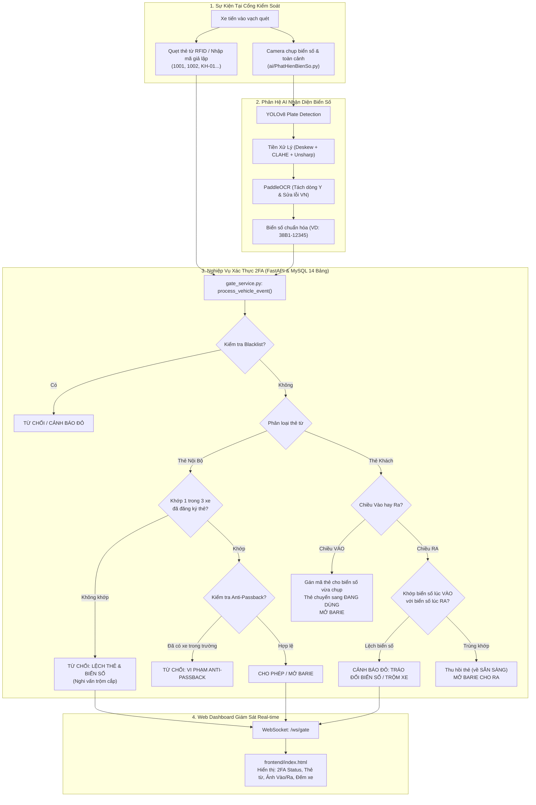

# TÀI LIỆU KIẾN TRÚC & LUỒNG HOẠT ĐỘNG HỆ THỐNG VINHGATE 2.0 (BẢN HỢP NHẤT)

> **Đề tài**: Hệ thống Quản lý Xe Ra Vào Đại học Vinh bằng Thị giác Máy tính  
> **Thư mục dự án mới**: `D:\VinhGate_new`  
> **Phiên bản**: 2.1 (Tích hợp Xác thực 2 Yếu tố: Thẻ Từ RFID / Giả lập mã + Biển số AI)  

---

## 📌 1. Tổng Quan Về Kiến Trúc Mới

Hệ thống **`VinhGate_new`** áp dụng cơ chế xác thực **2 yếu tố (Two-Factor Authentication - 2FA)**:
1. **Yếu tố Vật lý (Thẻ từ RFID / Mã thẻ định danh)**:
   - Mỗi sinh viên / cán bộ được cấp 1 thẻ từ duy nhất, có thể đăng ký **tối đa 3 biển số xe**.
   - Khách vãng lai được cấp thẻ tạm thời xoay vòng tại cổng vào và thu hồi tại cổng ra.
2. **Yếu tố Thị giác Máy tính (AI Camera ANPR)**:
   - Mô hình YOLOv8 phát hiện biển số & xe.
   - Chuỗi tiền xử lý `ai/TienXuLy/` (Cân góc nghiêng Deskew, CLAHE LAB, Unsharp Masking).
   - Module `ai/ChuanHoaBienSo/` sử dụng PaddleOCR Engine tách dòng trên/dưới theo trục Y và chuẩn hóa định dạng biển số Việt Nam (xe máy thường, xe điện 50cc 2 chữ cái `37AB`, ô tô 1 dòng).
3. **Quy tắc An ninh Chống Trộm Xe & Gian lận**:
   - **Chống trộm xe nội bộ**: Kẻ gian lấy xe dắt qua cổng nhưng không có thẻ hoặc quẹt sai thẻ $\to$ Barie giữ đóng và báo động đỏ.
   - **Quy tắc Anti-Passback**: 1 thẻ nội bộ dù có 3 xe nhưng tại 1 thời điểm chỉ cho phép duy nhất 1 xe đang nằm trong trường.
   - **Chống tráo đổi biển xe khách**: Khách lúc ra phải trả thẻ, hệ thống đối soát biển số lúc ra với biển số lúc vào gắn với thẻ này $\to$ Nếu lệch biển $\to$ Báo động đỏ khẩn cấp.
   - **Phân luồng làn**: Làn riêng cho xe nội bộ và Làn riêng cho xe khách.

---

## 🔄 2. Sơ Đồ Luồng Xác Thực 2 Yếu Tố (End-to-End Workflow)



---

## 📊 3. Bảng CSDL 14 Bảng Chuẩn 3NF (Bổ Sung Thẻ Từ)

| STT | Tên Bảng | Vai trò nghiệp vụ | Điểm mới bổ sung |
| :---: | :--- | :--- | :--- |
| **1** | **`cong`** | Danh sách các cổng trường (Cổng chính Lê Duẩn, Cổng KTX). | Giữ nguyên. |
| **2** | **`camera`** | Quản lý thiết bị camera giám sát. | Bổ sung cột **`loai_lan`** (`NOI_BO`, `KHACH`, `HON_HOP`) để phân luồng làn. |
| **3** | **`vai_tro`** | Phân quyền: `ADMIN`, `QUAN_LY`, `NHAN_VIEN_CONG`. | Giữ nguyên. |
| **4** | **`tai_khoan`** | Tài khoản đăng nhập chốt trực bảo vệ / quản lý. | Giữ nguyên. |
| **5** | **`nguoi_dung`** | Cán bộ, giảng viên, sinh viên Đại học Vinh. | Giữ nguyên. |
| **6** | **`the_tu`** | **[BẢNG MỚI]** Quản lý kho thẻ từ RFID (Nội bộ & Khách). | Lưu UID mã thẻ, trạng thái (`SAN_SANG`, `DANG_SU_DUNG`, `KHOA`, `DA_MAT`), chủ thẻ. |
| **7** | **`phuong_tien`** | Xe nội bộ đăng ký vé tháng. | Bổ sung khóa ngoại **`the_tu_id`** (1 thẻ đăng ký tối đa 3 xe). |
| **8** | **`khach`** | Thông tin khách vãng lai (họ tên, CCCD, đơn vị). | Giữ nguyên. |
| **9** | **`dang_ky_khach`** | Phiếu khách tạm thời (Cách B). | Bổ sung khóa ngoại **`the_tu_id`** để gán thẻ khách xoay vòng. |
| **10** | **`danh_sach_den`**| Blacklist các xe vi phạm trật tự, xe trộm cắp. | Giữ nguyên. |
| **11** | **`luot_ra_vao`** | Nhật ký trung tâm các lượt xe qua cổng. | Bổ sung cột **`ma_the_quyet`** và **`the_tu_id`** phục vụ đối chiếu 2FA. |
| **12** | **`hinh_anh_luot`**| Lưu ảnh toàn cảnh và ảnh crop biển số. | Hỗ trợ đối chiếu ảnh lúc VÀO vs lúc RA khi khách trả thẻ. |
| **13** | **`canh_bao`** | Cảnh báo an ninh và kỹ thuật. | Bổ sung loại cảnh báo: `THE_KHONG_KHOP_BIEN_SO`, `THE_VI_PHAM_ANTI_PASSBACK`, `THE_KHACH_LECH_BIEN_SO_RA_VAO`, `DI_SAI_LAN_QUY_DINH`. |
| **14** | **`nhat_ky_he_thong`** | Nhật ký thao tác hệ thống (Audit log). | Giữ nguyên. |

---

## 🛠️ 4. Hướng Dẫn Vận Hành & Thử Nghiệm Nhanh

1. **Khởi tạo / Cập nhật CSDL MySQL 14 bảng**:
   ```bash
   python scripts/init_db.py
   ```
   *(Hoặc chạy script nâng cấp `database/migrations/v3_add_card_system.sql` trên MySQL).*

2. **Khởi chạy Máy chủ Backend**:
   ```bash
   uvicorn backend.main:app --host 0.0.0.0 --port 8000 --reload
   ```

3. **Mở Trình duyệt kiểm thử**:
   * Truy cập: [http://localhost:8000/frontend/index.html](http://localhost:8000/frontend/index.html)
   * Tại màn hình Giám sát cổng, bạn có thể:
     - Thử nghiệm các nút kịch bản bấm nhanh:
       - **Kịch bản 1**: SV Hà đi xe 1 (`38B1-12345` quẹt thẻ `1001`) $\to$ **Mở Barie**.
       - **Kịch bản 2**: SV Hà đi xe 2 (`37AB-12206` quẹt thẻ `1001`) $\to$ **Mở Barie** (Chứng minh 1 thẻ dùng được 2-3 xe).
       - **Kịch bản 3**: Kẻ gian dắt trộm xe quẹt thẻ `1001` nhưng camera nhận biển `29A-88888` $\to$ **Còi báo động đỏ, Barie giữ đóng**.
       - **Kịch bản 4**: Quẹt thẻ `1002` vào 2 lần liên tiếp $\to$ **Chặn do vi phạm Anti-Passback**.
       - **Kịch bản 5**: Cấp thẻ `KH-02` cho khách vào.
       - **Kịch bản 6**: Khách ra trả thẻ `KH-01` nhưng bị tráo biển $\to$ **Cảnh báo đỏ tráo biển số**.
